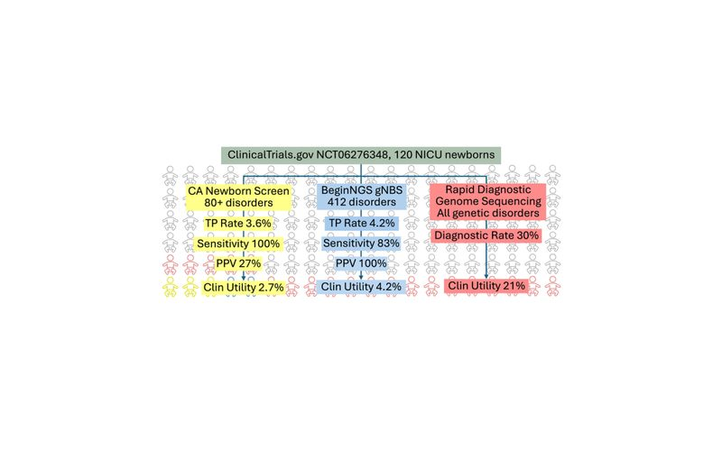
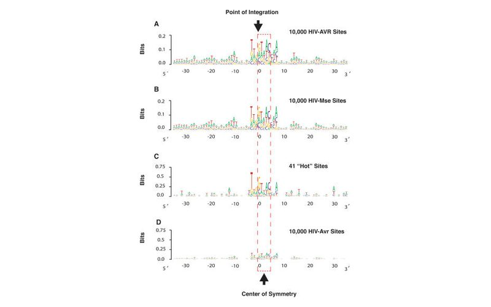
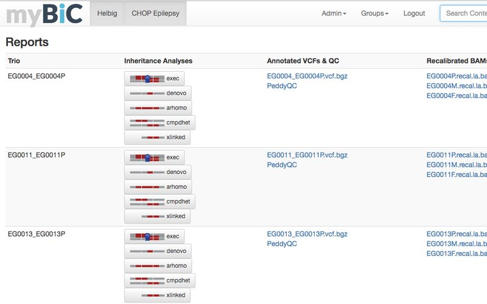
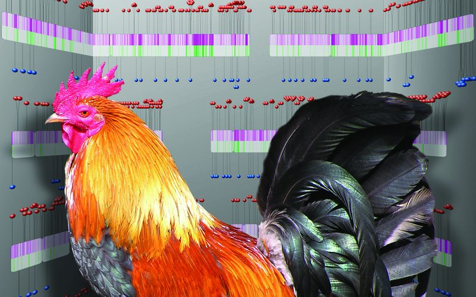
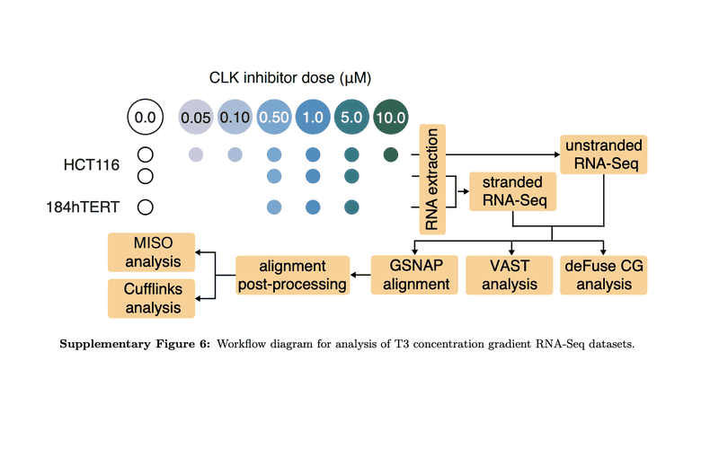
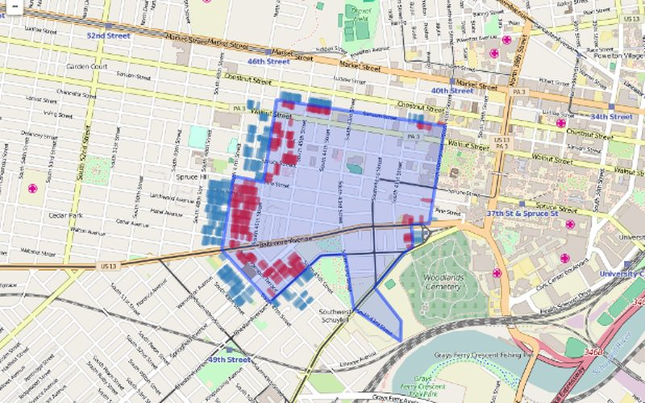

<!-- Generated by scripts/build_site.py from data/*.yml. Do not edit. -->

<section class="home-section split" markdown>

About

<h2>Software for seeing, exploring and publishing biological data</h2>

Technical product manager for the population-genomics line at Tile.ai (formerly known as TileDB) and a bioinformatics leader with 25+ years bridging genomics R&amp;D and enterprise software. I develop scalable genomics data products from concept through launch, translating genetics research and discovery workflows into enterprise-grade platforms used by pharma and biotech partners, owning product vision, roadmaps, and success metrics while partnering across science, engineering, and business.

I have helped four diagnostic, therapeutic, and SaaS startups define and implement their product strategy, bridging cutting-edge research and practical commercial applications. My expertise spans low-level algorithm development through high-level product strategy and customer engagement.

As a researcher, I have authored over 50 publications with an h-index of 30, contributing to fields including HIV integration site analysis, mitochondrial genetics, reproducible research methodologies, and computational pipeline development. My work has been published in prestigious journals including Cell, Nature, PLoS Computational Biology, and Genome Research.

<aside class="panel">

At a glance

<ul class="highlights">
<li>Technical product manager for the population-genomics line, including TileDB-VCF, at Tile.ai (formerly known as TileDB)</li>
<li>Supports 5 major biopharma and hospital customers; involved in the sales process for 30+ prospects</li>
<li>Primary industry partner contact for the BeginNGS pediatric newborn screening consortium</li>
<li>Helped four diagnostic, therapeutic, and SaaS startups define and implement their product strategy</li>
<li>25+ years bridging genomics R&amp;D and enterprise software</li>
<li>BS in Biology, MS in Computer Science, PhD in Information Science</li>
<li>40+ peer-reviewed publications, h-index of 30; author of O&#x27;Reilly&#x27;s Data Mashups in R</li>
<li>Founder of the PhillyR user community</li>
</ul>
</aside>
</section>

<section class="home-section">

Research
<h2>Selected publications</h2>
<a class="more" href="publications/">All publications &rarr;</a>

<article class="pub-card" data-search="genome-based newborn screening for severe childhood genetic diseases has high positive predictive value and sensitivity in a nicu pilot trial american journal of human genetics 2024 kingsmore sf, wright m, olsen l, schultz b, protopsaltis l, averbuj d, blincow e, carroll j, caylor s, defay t, ellsworth k, feigenbaum a, gover m, guidugli l, hansen c, van der kraan l, kunard cm, kwon h, madhavrao l, leipzig j, liang y, mardach r, mowrey wr, nguyen h, niemi ak, oh d, saad m, scharer g, schleit j, mehtalia ss, sanford e, smith ld, willis mj, wigby k, reimers r. (2024). &quot;genome-based newborn screening for severe childhood genetic diseases has high positive predictive value and sensitivity in a nicu pilot trial.&quot; &lt;i&gt;am j hum genet&lt;/i&gt; 111(12):2643-2667.">
  
  

    
American Journal of Human Genetics2024

    <h3><a href="https://doi.org/10.1016/j.ajhg.2024.10.020">Genome-based newborn screening for severe childhood genetic diseases has high positive predictive value and sensitivity in a NICU pilot trial</a></h3>
    
    
Kingsmore SF, Wright M, Olsen L, Schultz B, Protopsaltis L, Averbuj D, Blincow E, Carroll J, Caylor S, Defay T, Ellsworth K, Feigenbaum A, Gover M, Guidugli L, Hansen C, Van Der Kraan L, Kunard CM, Kwon H, Madhavrao L, <b>Leipzig J</b>, Liang Y, Mardach R, Mowrey WR, Nguyen H, Niemi AK, Oh D, Saad M, Scharer G, Schleit J, Mehtalia SS, Sanford E, Smith LD, Willis MJ, Wigby K, Reimers R

    
Large prospective clinical trials are underway or planned that examine the clinical utility and cost effectiveness of genome-based newborn screening (gNBS).

    <a class="pub-card__link" href="https://doi.org/10.1016/j.ajhg.2024.10.020">Paper &rarr;</a>
  

</article>
<article class="pub-card" data-search="the role of metadata in reproducible computational research patterns 2021 leipzig j, nüst d, hoyt ct, ram k, greenberg j. (2021). &quot;the role of metadata in reproducible computational research.&quot; &lt;i&gt;patterns&lt;/i&gt; 2(9):100322.">
  
  

    
Patterns2021

    <h3><a href="https://doi.org/10.1016/j.patter.2021.100322">The role of metadata in reproducible computational research</a></h3>
    
    
<b>Leipzig J</b>, Nüst D, Hoyt CT, Ram K, Greenberg J

    
This paper discusses the critical role of metadata in ensuring reproducible computational research.

    <a class="pub-card__link" href="https://doi.org/10.1016/j.patter.2021.100322">Paper &rarr;</a>
  

</article>
<article class="pub-card" data-search="a review of bioinformatic pipeline frameworks briefings in bioinformatics 2017 leipzig j. (2017). &quot;a review of bioinformatic pipeline frameworks.&quot; &lt;i&gt;brief bioinform&lt;/i&gt; 18(3):530-536.">
  
  

    
Briefings in Bioinformatics2017

    <h3><a href="https://doi.org/10.1093/bib/bbw020">A review of bioinformatic pipeline frameworks</a></h3>
    
ISI Top 1% Highly Cited

    
<b>Leipzig J</b>

    
This paper provides a comprehensive review of bioinformatic pipeline frameworks.

    <a class="pub-card__link" href="https://doi.org/10.1093/bib/bbw020">Paper &rarr;</a>
  

</article>
<article class="pub-card" data-search="de novo mutations in histone-modifying genes in congenital heart disease nature 2013 zaidi s, choi m, wakimoto h, ma l, jiang j, overton jd, romano-adesman a, bjornson rd, breitbart re, brown kk, carriero nj, cheung yh, deanfield j, depalma s, fakhro ka, glessner j, hakonarson h, italia mj, kaltman jr, kaski j, kim r, kline jk, lee t, leipzig j, lopez a, mane sm, mitchell le, newburger jw, parfenov m, pe&#x27;er i, porter g, roberts ae, sachidanandam r, sanders sj, seiden hs, state mw, subramanian s, tikhonova ir, wang w, warburton d, white ps, williams ia, zhao h, seidman jg, brueckner m, chung wk, gelb bd, goldmuntz e, seidman ce, lifton rp. (2013). &quot;de novo mutations in histone-modifying genes in congenital heart disease.&quot; &lt;i&gt;nature&lt;/i&gt; 498(7453):220-223.">
  
  

    
Nature2013

    <h3><a href="https://doi.org/10.1038/nature12141">De novo mutations in histone-modifying genes in congenital heart disease</a></h3>
    
    
Zaidi S, Choi M, Wakimoto H, Ma L, Jiang J, Overton JD, Romano-Adesman A, Bjornson RD, Breitbart RE, Brown KK, Carriero NJ, Cheung YH, Deanfield J, DePalma S, Fakhro KA, Glessner J, Hakonarson H, Italia MJ, Kaltman JR, Kaski J, Kim R, Kline JK, Lee T, <b>Leipzig J</b>, Lopez A, Mane SM, Mitchell LE, Newburger JW, Parfenov M, Pe'er I, Porter G, Roberts AE, Sachidanandam R, Sanders SJ, Seiden HS, State MW, Subramanian S, Tikhonova IR, Wang W, Warburton D, White PS, Williams IA, Zhao H, Seidman JG, Brueckner M, Chung WK, Gelb BD, Goldmuntz E, Seidman CE, Lifton RP

    
This study identifies de novo mutations in histone-modifying genes associated with congenital heart disease.

    <a class="pub-card__link" href="https://doi.org/10.1038/nature12141">Paper &rarr;</a>
  

</article>
<article class="pub-card" data-search="data mashups in r o&#x27;reilly media 2009 leipzig j, li xiao-yi. (2009). &quot;data mashups in r.&quot; &lt;i&gt;o&#x27;reilly&lt;/i&gt;. (reissued in 2011)">
  
  

    
O&#x27;Reilly Media2009

    <h3><a href="https://www.oreilly.com/library/view/data-mashups-in/9780596804923/">Data Mashups in R</a></h3>
    
    
<b>Leipzig J</b>, Li Xiao-Yi

    
This book provides practical guidance for creating data mashups using the R statistical programming language.

    <a class="pub-card__link" href="https://www.oreilly.com/library/view/data-mashups-in/9780596804923/">Book &rarr;</a>
  

</article>
<article class="pub-card" data-search="hiv integration site selection: analysis by massively parallel pyrosequencing reveals association with epigenetic modifications genome research 2007 wang gp, ciuffi a, leipzig j, berry cc, bushman fd. (2007). &quot;hiv integration site selection: analysis by massively parallel pyrosequencing reveals association with epigenetic modifications.&quot; &lt;i&gt;genome res&lt;/i&gt; 17(8):1186-1194.">
  
  

    
Genome Research2007

    <h3><a href="https://doi.org/10.1101/gr.6286907">HIV integration site selection: analysis by massively parallel pyrosequencing reveals association with epigenetic modifications</a></h3>
    
    
Wang GP, Ciuffi A, <b>Leipzig J</b>, Berry CC, Bushman FD

    
This paper uses massively parallel pyrosequencing to analyze HIV integration site selection and its association with epigenetic modifications.

    <a class="pub-card__link" href="https://doi.org/10.1101/gr.6286907">Paper &rarr;</a>
  

</article>

</section>

<section class="home-section spotlight">

Current project

<h2>Rhylthyme</h2>

A JSON-based markup language and toolchain for describing real-time programs that coordinate parallel tracks of work with resource constraints, timing dependencies, and flexible execution patterns. Includes a CLI runner, web visualizer, and MCP server for AI-assisted schedule generation.

<a class="md-button md-button--primary" href="rhylthyme/">Architecture &amp; screenshots</a>

</section>

<section class="home-section">

Open source
<h2>Software &amp; projects</h2>
<a class="more" href="portfolio/">All software &rarr;</a>

<a class="sw-card" href="https://mitomap.org/mitomaster/">
  

  

    
Web Application

    <h3>MITOMASTER</h3>
    
Web application that allows clinicians to quickly investigate mitochondrial mutations in sequenced or genotyped samples. Used worldwide for mitochondrial genetics research.

  

</a>

  

  

    
Django/Python

    <h3>myBiC</h3>
    
Django application that manages user authentication and presentation of bioinformatics deliverables. Streamlines report delivery for core facilities.

  

  

  

    
Pipeline

    <h3>InSiPiD</h3>
    
Integration Site Pipeline and Database - comprehensive toolset for managing viral integration site data processing, annotation, and analysis.

  

<a class="sw-card" href="rhylthyme/">
  

  

    
Python · 2025

    <h3>Rhylthyme Case study</h3>
    
A JSON-based markup language and toolchain for describing real-time programs that coordinate parallel tracks of work with resource constraints, timing dependencies, and flexible execution patterns. Includes a CLI runner, web visualizer, and MCP server for AI-assisted schedule generation.

  

</a>
<a class="sw-card" href="https://leipzig.github.io/dimoose/">
  

  

    
R · 2020

    <h3>dimoose</h3>
    
R package for dichotomous identification keys. Build a key from a plain spreadsheet with photos, draw it as a box diagram, or turn it into an offline web wizard for the field; also imports FishBase keys and generates keys from photos (CLIP/BioCLIP), sequence alignments and trait matrices. Includes an illustrated key to Montana&#x27;s native broadleaf trees.

  

</a>
<a class="sw-card" href="https://github.com/leipzig/awesome-reproducible-research">
  

  

    
Python · 2017

    <h3>awesome-reproducible-research</h3>
    
A curated list of reproducible research case studies, projects, tutorials, and media. Community-driven resource with 356+ stars.

  

</a>
<a class="sw-card" href="https://github.com/leipzig/berrylogo">
  

  

    
R · 2011

    <h3>berrylogo</h3>
    
A better seqLogo implementation for creating sequence logos in R. Enhanced visualization tool with 12+ stars.

  

</a>
<a class="sw-card" href="https://github.com/leipzig/opensnp">
  

  

    
HTML/R · 2016

    <h3>opensnp</h3>
    
Validation of published GWAS studies using OpenSNP volunteered data. Binderized for reproducible analysis.

  

</a>
<a class="sw-card" href="https://github.com/leipzig/clk">
  

  

    
Python

    <h3>clk</h3>
    
Command-line toolkit for bioinformatics workflows and data processing automation.

  

</a>
<a class="sw-card" href="http://leipzig.github.io/PAS_Premium/">
  

  

    
R/Snakemake · 2016

    <h3>PAS_Premium</h3>
    
What do people pay to live in the Penn Alexander School catchment? A fully reproducible housing-price analysis of the West Philadelphia catchment, built with Snakemake, R, Conda and Docker.

  

</a>

</section>

<section class="home-section split">

Interests

<h2>What I work on</h2>

<h3>Reproducible Research &amp; Metadata</h3>
Developing frameworks and tools to ensure computational reproducibility in biological research, with focus on metadata standards and pipeline documentation

<h3>Genomic Variant Analysis</h3>
Creating tools for mitochondrial genetics, exome analysis, and clinical genomics applications with emphasis on rare disease diagnostics

<h3>Cloud-Scale Bioinformatics</h3>
Building scalable workflows and platforms for population genomics, drug discovery, and precision medicine using AWS and GCP infrastructure

<h3>Bioinformatics Product Strategy</h3>
Translating research methodologies into commercial bioinformatics products, from startup strategy to enterprise solutions

<aside class="panel">

Recent roles

<ul class="roles">
<li>2022 – Present<b>Product Manager</b> · Tile.ai (formerly known as TileDB)</li>
<li>2020 – 2022<b>Bioinformatics Lead</b> · Truwl</li>
<li>2018 – 2019<b>Bioinformatics Engineer</b> · Panorama Medicine</li>
<li>2017 – 2018<b>Senior Bioinformatics Scientist</b> · CytoVas LLC</li>
<li>2010 – 2017<b>Senior Data Integration Analyst</b> · Children&#x27;s Hospital of Philadelphia (CHOP)</li>
</ul>
<a class="more" href="experience/">Full experience &rarr;</a>
</aside>
</section>
