<!-- Generated by scripts/build_site.py from data/*.yml. Do not edit. -->

<section class="home-section split" markdown>

About

<h2>Software for seeing, exploring and publishing biological data</h2>

I am a bioinformatics veteran with over 25 years of experience spanning academic research, startup environments, and product management. My career has been dedicated to developing bioinformatics tools and platforms that enable researchers to visualize, explore, and publish their data.

Throughout my career, I have helped four diagnostic, therapeutic, and SaaS startups define their bioinformatic product strategy, successfully bridging the gap between cutting-edge research and practical commercial applications. My expertise encompasses the full spectrum of bioinformatics, from low-level algorithm development to high-level product strategy and customer engagement.

As a researcher, I have authored over 50 publications with an h-index of 30, contributing to fields including HIV integration site analysis, mitochondrial genetics, reproducible research methodologies, and computational pipeline development. My work has been published in prestigious journals including Cell, Nature, PLoS Computational Biology, and Genome Research.

<aside class="panel">

At a glance

<ul class="highlights">
<li>25+ years of experience spanning bioinformatics research, product management, and software development across academia and industry</li>
<li>Led four diagnostic, therapeutic and SaaS startups in defining their bioinformatic product strategy</li>
<li>BS in Bio, MS in CS, PhD in Information Science</li>
<li>40+ peer-reviewed publications (4 first authorships). h-index of 30.</li>
<li>Expert in developing cloud-based pipelines for genomics, transcriptomics, and clinical applications</li>
<li>Founder of PhillyR user group and top-20 contributor to biostars.org bioinformatics Q&amp;A community</li>
<li>Proven track record in scaling bioinformatics workflows from research prototypes to production systems</li>
<li>Author of O&#x27;Reilly book &#x27;Data Mashups in R&#x27; and multiple bioinformatics software tools</li>
</ul>
</aside>
</section>

<section class="home-section">

Research
<h2>Selected publications</h2>
<a class="more" href="publications/">All publications &rarr;</a>

<article class="pub-card" data-search="the role of metadata in reproducible computational research cell patterns 2021 leipzig, j., nüst, d., hoyt, c.t., ram, k., and greenberg, j. (2021). &quot;the role of metadata in reproducible computational research.&quot; &lt;i&gt;cell patterns&lt;/i&gt;. 2021, 100322.">
  <a class="pub-card__media" href="https://doi.org/10.1016/j.patter.2021.100322" tabindex="-1" aria-hidden="true">
    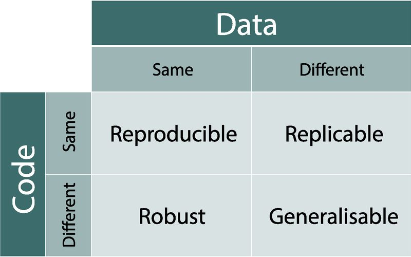
  </a>
  

    
Cell Patterns2021

    <h3><a href="https://doi.org/10.1016/j.patter.2021.100322">The role of metadata in reproducible computational research</a></h3>
    
<b>Leipzig, J.</b>, Nüst, D., Hoyt, C.T., Ram, K., and Greenberg, J

    
This paper discusses the critical role of metadata in ensuring reproducible computational research.

    <a class="pub-card__link" href="https://doi.org/10.1016/j.patter.2021.100322">Paper &rarr;</a>
  

</article>
<article class="pub-card" data-search="a review of bioinformatic pipeline frameworks* briefings in bioinformatics 2017 leipzig, j. (2017). &quot;a review of bioinformatic pipeline frameworks.&quot; &lt;i&gt;briefings in bioinformatics&lt;/i&gt;. 2016 10.1093/bib/bbw020.">
  <a class="pub-card__media" href="https://doi.org/10.1093/bib/bbw020" tabindex="-1" aria-hidden="true">
    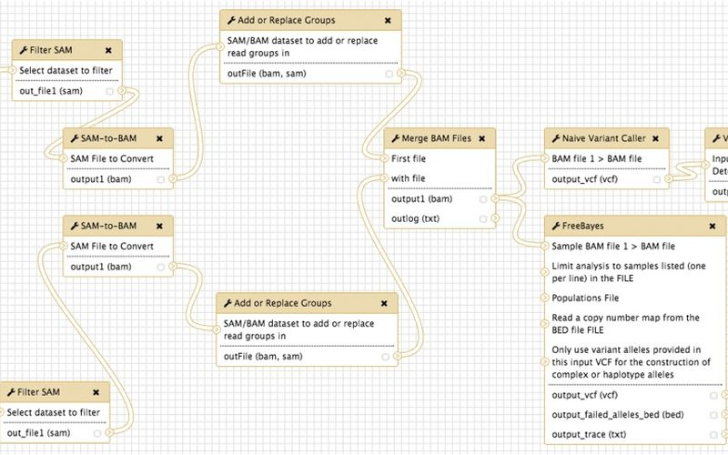
  </a>
  

    
Briefings in Bioinformatics2017

    <h3><a href="https://doi.org/10.1093/bib/bbw020">A review of bioinformatic pipeline frameworks*</a></h3>
    
<b>Leipzig, J</b>

    
This paper provides a comprehensive review of bioinformatic pipeline frameworks.

    <a class="pub-card__link" href="https://doi.org/10.1093/bib/bbw020">Paper &rarr;</a>
  

</article>
<article class="pub-card" data-search="de novo mutations in histone-modifying genes in congenital heart disease nature 2013 zaidi, s., choi, m., wakimoto, h., ma, l., jiang, j., overton, j.d., romano-adesman, a., bjornson, r.d., breitbart, r.e., brown, k.k., carriero, n.j., cheung, y.h., deanfield, j., depalma, s., fakhro, k.a., glessner, j., hakonarson, h., italia, m.j., kaltman, j.r., kaski, j., kim, r., kline, j.k., lee, t., leipzig, j., ... &amp; lifton, r.p. (2013). de novo mutations in histone-modifying genes in congenital heart disease. nature, 498(7453), 220-223.">
  <a class="pub-card__media" href="https://www.nature.com/articles/nature12141" tabindex="-1" aria-hidden="true">
    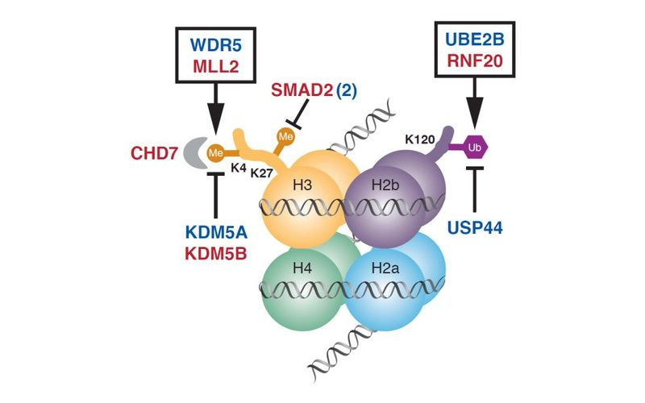
  </a>
  

    
Nature2013

    <h3><a href="https://www.nature.com/articles/nature12141">De novo mutations in histone-modifying genes in congenital heart disease</a></h3>
    
Zaidi, S., Choi, M., Wakimoto, H., Ma, L., Jiang, J., Overton, J.D., Romano-Adesman, A., Bjornson, R.D., Breitbart, R.E., Brown, K.K., Carriero, N.J., Cheung, Y.H., Deanfield, J., DePalma, S., Fakhro, K.A., Glessner, J., Hakonarson, H., Italia, M.J., Kaltman, J.R., Kaski, J., Kim, R., Kline, J.K., Lee, T., <b>Leipzig, J.</b>, ... & Lifton, R.P

    
This study identifies de novo mutations in histone-modifying genes associated with congenital heart disease.

    <a class="pub-card__link" href="https://www.nature.com/articles/nature12141">Paper &rarr;</a>
  

</article>
<article class="pub-card" data-search="integrated systems approach identifies genetic nodes and networks in late-onset alzheimer&#x27;s disease cell 2013 zhang, b., gaiteri, c., bodea, l.g., wang, z., mcelwee, j., podtelezhnikov, a.a., zhang, c., xie, t., tran, l., dobrin, r., fluder, e., clurman, b., melquist, s., narayanan, m., suver, c., shah, h., mahajan, m., gillis, t., mysore, j., macdonald, m.e., lamb, j.r., bennett, d.a., molony, c., stone, d.j., gudnason, v., myers, a.j., schadt, e.e., neumann, h., zhu, j., &amp; emilsson, v. (2013). integrated systems approach identifies genetic nodes and networks in late-onset alzheimer&#x27;s disease. cell, 153(3), 707-720.">
  <a class="pub-card__media" href="https://www.cell.com/cell/fulltext/S0092-8674(13)00355-7" tabindex="-1" aria-hidden="true">
    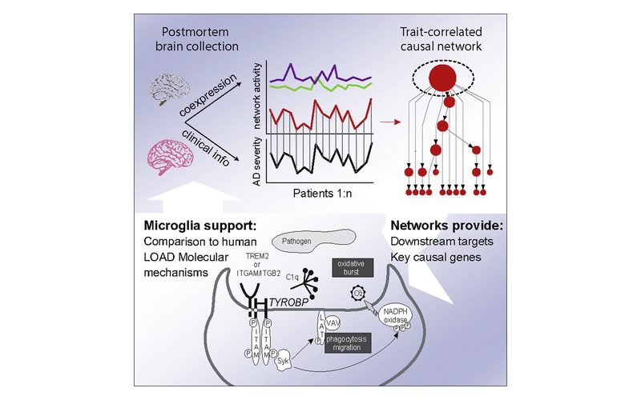
  </a>
  

    
Cell2013

    <h3><a href="https://www.cell.com/cell/fulltext/S0092-8674(13)00355-7">Integrated systems approach identifies genetic nodes and networks in late-onset Alzheimer&#x27;s disease</a></h3>
    
Zhang, B., Gaiteri, C., Bodea, L.G., Wang, Z., McElwee, J., Podtelezhnikov, A.A., Zhang, C., Xie, T., Tran, L., Dobrin, R., Fluder, E., Clurman, B., Melquist, S., Narayanan, M., Suver, C., Shah, H., Mahajan, M., Gillis, T., Mysore, J., MacDonald, M.E., Lamb, J.R., Bennett, D.A., Molony, C., Stone, D.J., Gudnason, V., Myers, A.J., Schadt, E.E., Neumann, H., Zhu, J., & Emilsson, V

    
This study uses an integrated systems approach to identify genetic nodes and networks in late-onset Alzheimer disease.

    <a class="pub-card__link" href="https://www.cell.com/cell/fulltext/S0092-8674(13)00355-7">Paper &rarr;</a>
  

</article>
<article class="pub-card" data-search="data mashups in r o&#x27;reilly media 2009 leipzig j, li xiao-yi. (2009). &quot;data mashups in r.&quot; &lt;i&gt;o&#x27;reilly&lt;/i&gt;. (reissued in 2011)">
  <a class="pub-card__media" href="https://www.oreilly.com/library/view/data-mashups-in/9780596804923/" tabindex="-1" aria-hidden="true">
    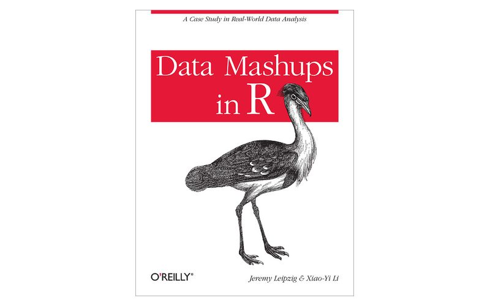
  </a>
  

    
O&#x27;Reilly Media2009

    <h3><a href="https://www.oreilly.com/library/view/data-mashups-in/9780596804923/">Data Mashups in R</a></h3>
    
<b>Leipzig J</b>, Li Xiao-Yi

    
This book provides practical guidance for creating data mashups using the R statistical programming language.

    <a class="pub-card__link" href="https://www.oreilly.com/library/view/data-mashups-in/9780596804923/">Book &rarr;</a>
  

</article>
<article class="pub-card" data-search="hiv integration site selection: analysis by massively parallel pyrosequencing reveals association with epigenetic modifications genome research 2007 wang gp, ciuffi a, leipzig j, berry cc, bushman fd. (2007). &quot;hiv integration site selection: analysis by massively parallel pyrosequencing reveals association with epigenetic modifications.&quot; &lt;i&gt;genome res.&lt;/i&gt; 17(8):1186-94.">
  
  

    
Genome Research2007

    <h3><a href="https://doi.org/10.1101/gr.6286907">HIV integration site selection: analysis by massively parallel pyrosequencing reveals association with epigenetic modifications</a></h3>
    
Wang GP, Ciuffi A, <b>Leipzig J</b>, Berry CC, Bushman FD

    
This paper uses massively parallel pyrosequencing to analyze HIV integration site selection and its association with epigenetic modifications.

    <a class="pub-card__link" href="https://doi.org/10.1101/gr.6286907">Paper &rarr;</a>
  

</article>

</section>

<section class="home-section spotlight">

Current project

<h2>Rhylthyme</h2>

A JSON-based markup language and toolchain for describing real-time programs that coordinate parallel tracks of work with resource constraints, timing dependencies, and flexible execution patterns. Includes a CLI runner, web visualizer, and MCP server for AI-assisted schedule generation.

<a class="md-button md-button--primary" href="rhylthyme/">Architecture &amp; screenshots</a>

<a href="rhylthyme/">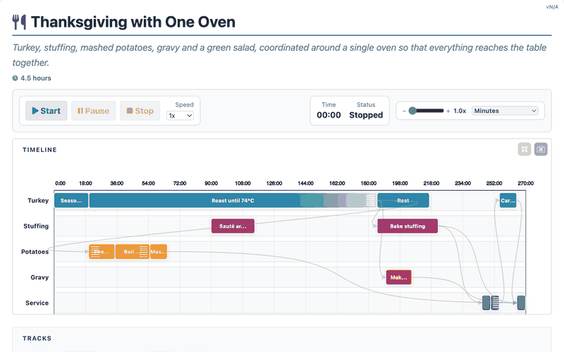</a>
</section>

<section class="home-section">

Open source
<h2>Software &amp; projects</h2>
<a class="more" href="portfolio/">All software &rarr;</a>

<a class="sw-card" href="https://mitomap.org/mitomaster/">
  
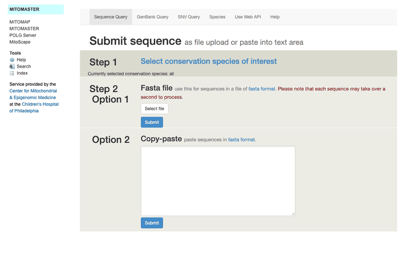

  

    
Web Application

    <h3>MITOMASTER</h3>
    
Web application that allows clinicians to quickly investigate mitochondrial mutations in sequenced or genotyped samples. Used worldwide for mitochondrial genetics research.

  

</a>

  

  

    
Django/Python

    <h3>myBiC</h3>
    
Django application that manages user authentication and presentation of bioinformatics deliverables. Streamlines report delivery for core facilities.

  

  

  

    
Pipeline

    <h3>InSiPiD</h3>
    
Integration Site Pipeline and Database - comprehensive toolset for managing viral integration site data processing, annotation, and analysis.

  

<a class="sw-card" href="rhylthyme/">
  

  

    
Python · 2025

    <h3>Rhylthyme Case study</h3>
    
A JSON-based markup language and toolchain for describing real-time programs that coordinate parallel tracks of work with resource constraints, timing dependencies, and flexible execution patterns. Includes a CLI runner, web visualizer, and MCP server for AI-assisted schedule generation.

  

</a>
<a class="sw-card" href="https://leipzig.github.io/dimoose/">
  
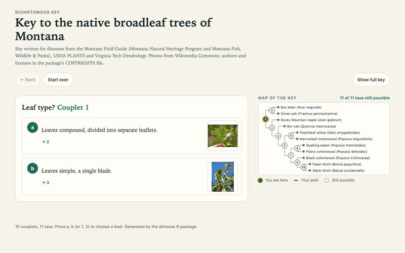

  

    
R · 2020

    <h3>dimoose</h3>
    
R package for dichotomous identification keys. Build a key from a plain spreadsheet with photos, draw it as a box diagram, or turn it into an offline web wizard for the field; also imports FishBase keys and generates keys from photos (CLIP/BioCLIP), sequence alignments and trait matrices. Includes an illustrated key to Montana&#x27;s native broadleaf trees.

  

</a>
<a class="sw-card" href="https://github.com/leipzig/awesome-reproducible-research">
  

  

    
Python · 2017

    <h3>awesome-reproducible-research</h3>
    
A curated list of reproducible research case studies, projects, tutorials, and media. Community-driven resource with 356+ stars.

  

</a>
<a class="sw-card" href="https://github.com/leipzig/SandwichesWithSnakemake">
  
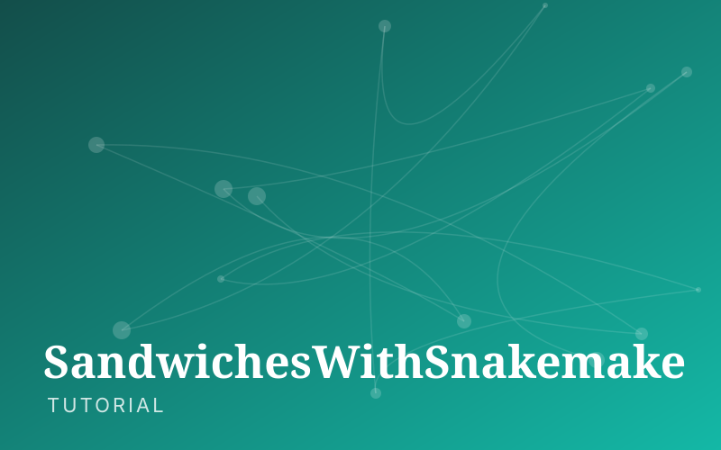

  

    
Tutorial · 2014

    <h3>SandwichesWithSnakemake</h3>
    
Beginner&#x27;s tutorial to Snakemake workflow management system. Popular educational resource with 70+ stars.

  

</a>
<a class="sw-card" href="https://github.com/leipzig/snakemake-example">
  

  

    
CSS/Snakemake · 2014

    <h3>snakemake-example</h3>
    
RNA-Seq Snakemake example with Jekyll homepage creation. Complete workflow demonstration with 20+ stars.

  

</a>
<a class="sw-card" href="https://github.com/leipzig/berrylogo">
  
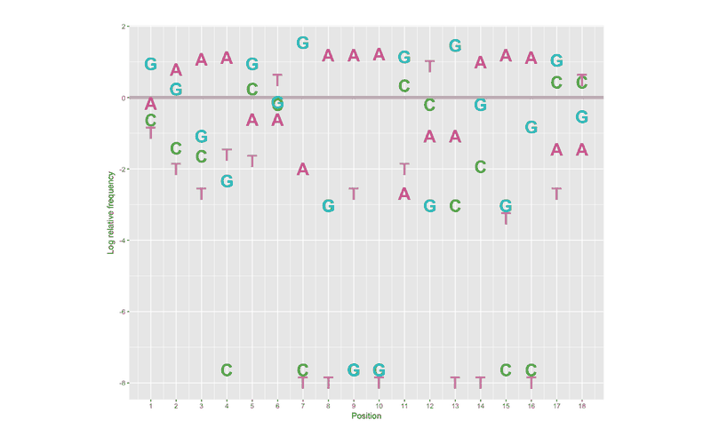

  

    
R · 2011

    <h3>berrylogo</h3>
    
A better seqLogo implementation for creating sequence logos in R. Enhanced visualization tool with 12+ stars.

  

</a>
<a class="sw-card" href="https://github.com/leipzig/ancestryinformativemarkers">
  
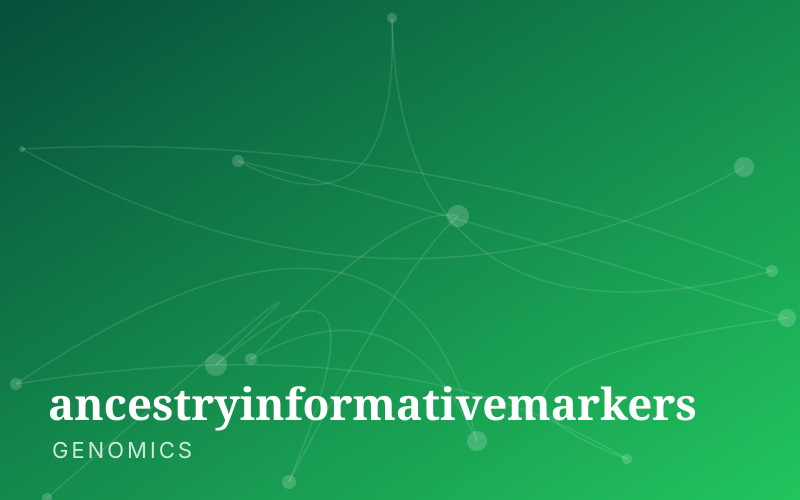

  

    
Genomics · 2022

    <h3>ancestryinformativemarkers</h3>
    
Public Ancestry Informative Markers (AIMs) dataset and tools for population genetics analysis.

  

</a>
<a class="sw-card" href="https://github.com/leipzig/opensnp">
  
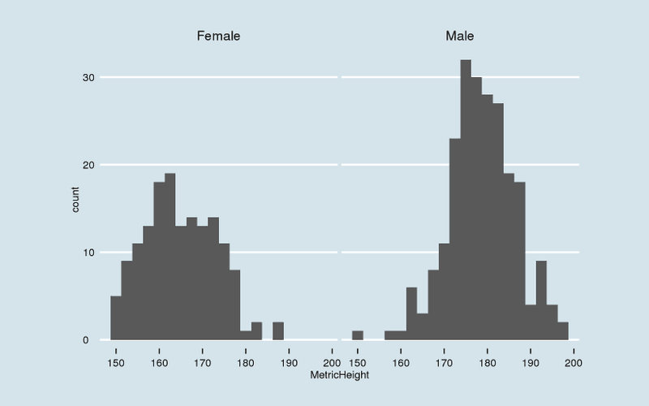

  

    
HTML/R · 2016

    <h3>opensnp</h3>
    
Validation of published GWAS studies using OpenSNP volunteered data. Binderized for reproducible analysis.

  

</a>
<a class="sw-card" href="https://github.com/leipzig/blast-wrapper">
  

  

    
Node.js · 2013

    <h3>blast-wrapper</h3>
    
Node.js web-service wrapper for fetching pairwise BLAST alignments against a fixed reference.

  

</a>
<a class="sw-card" href="https://github.com/leipzig/ontopop">
  

  

    
Python · 2020

    <h3>ontopop</h3>
    
Analysis tool to measure popularity and usage of biological ontologies across scientific literature.

  

</a>

</section>

<section class="home-section split">

Interests

<h2>What I work on</h2>

<h3>Reproducible Research &amp; Metadata</h3>
Developing frameworks and tools to ensure computational reproducibility in biological research, with focus on metadata standards and pipeline documentation

<h3>Genomic Variant Analysis</h3>
Creating tools for mitochondrial genetics, exome analysis, and clinical genomics applications with emphasis on rare disease diagnostics

<h3>Cloud-Scale Bioinformatics</h3>
Building scalable workflows and platforms for population genomics, drug discovery, and precision medicine using AWS and GCP infrastructure

<h3>Bioinformatics Product Strategy</h3>
Translating research methodologies into commercial bioinformatics products, from startup strategy to enterprise solutions

<aside class="panel">

Recent roles

<ul class="roles">
<li>08/2022 - Present<b>Product Manager</b> · TileDB</li>
<li>09/2020 - 07/2022<b>Bioinformatics Lead</b> · Truwl</li>
<li>09/2017 - 11/2019<b>Bioinformatics Engineer</b> · Panorama Medicine</li>
<li>06/2017 - 08/2018<b>Senior Bioinformatics Scientist</b> · CytoVas LLC</li>
<li>11/2010 - 06/2017<b>Senior Data Integration Analyst &amp; GRIN Informatics Lead</b> · Children&#x27;s Hospital of Philadelphia (CHOP)</li>
</ul>
<a class="more" href="experience/">Full experience &rarr;</a>
</aside>
</section>
