# Rhylthyme

<p class="lede">Rhylthyme ("real time") is a small language and runtime for multi-track schedules where the executor is a person. Several lines of work run in parallel, they share a few scarce resources (one oven, two thermocyclers, one squat rack), and some steps end only when the person says so. A program is plain JSON. Everything else is built around that file: a validator, a timing engine, a live timeline player, an MCP server that lets language-model agents write programs, importers, an R binding, lab-instrument bridges, and native apps.</p>

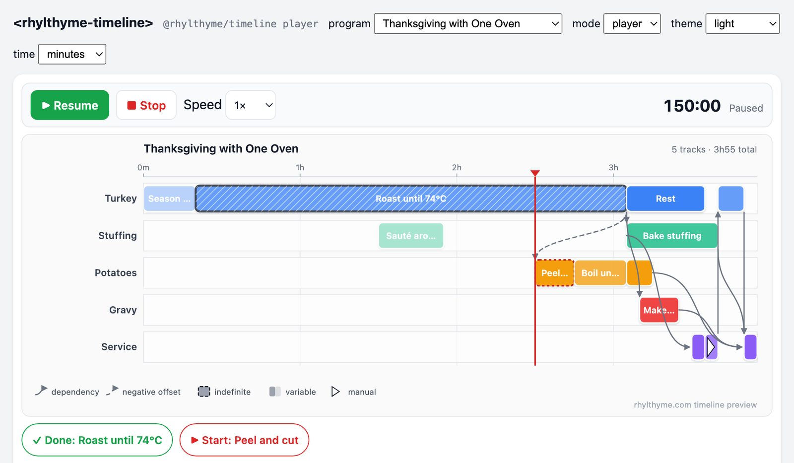

## What it is

Recipes, protocols and run sheets are "programs for people". Someone writes them for someone else to carry out, and they usually describe one idealized linear process. Existing tools tend to fall into one of three groups. Planners compute a schedule and hand over a static chart. Workflow engines execute a dependency graph on machines, with no person in the loop. Timer apps walk you through a checklist but know nothing about parallel work or shared equipment. Rhylthyme covers the gap between them: capacity-constrained, cross-track schedules that a human follows live.

The program model is small:

- **Tracks** are parallel lines of work. Steps within a track run one after another.
- **Steps** have a `duration`. It can be `fixed`, `variable` (min/default/max, and the person may end it early) or `indefinite` (it runs until the person ends it, so planning uses a default).
- **Start triggers** relate steps across tracks: `programStart`, `programStartOffset`, `afterStep` (with an optional signed offset, so "peel potatoes 45 minutes before the roast is due out" works), `afterStepWithBuffer`, `manual`, on-abort, and `all`/`any` combinations.
- **Resource constraints** cap concurrent use of a `task` type (`maxConcurrent`). An optional **environment** document declares the resources and actors of a particular kitchen, lab or gym.
- Newer schema versions add **replicates** (one step × N instances, with `maxInFlight`) and step **alerts** anchored to a step's start or end.

Here is a trimmed version of `breakfast_schedule.json` from [rhylthyme-examples](https://github.com/rhylthyme/rhylthyme-examples):

```json
{
  "programId": "breakfast-schedule",
  "name": "Breakfast Schedule",
  "environmentType": "kitchen",
  "tracks": [
    { "trackId": "bacon", "name": "Bacon", "steps": [
      { "stepId": "bacon-prep", "name": "Prepare Bacon", "task": "prep-work",
        "startTrigger": { "type": "programStart" },
        "duration": { "type": "fixed", "seconds": 60 } },
      { "stepId": "bacon-cook", "name": "Cook Bacon", "task": "stove-burner",
        "startTrigger": { "type": "afterStep", "stepId": "bacon-prep" },
        "duration": { "type": "variable", "minSeconds": 480,
                      "maxSeconds": 720, "defaultSeconds": 600 },
        "alerts": [{ "event": "end", "offsetSeconds": "-1m",
                     "message": "Check the bacon: pull it as soon as it is crisp" }] }
    ]},
    { "trackId": "toast", "name": "Toast", "steps": [
      { "stepId": "toast-cook", "name": "Make Toast", "task": "toaster",
        "startTrigger": { "type": "programStartOffset", "offsetSeconds": 480 },
        "duration": { "type": "fixed", "seconds": 210 } }
    ]}
  ],
  "resourceConstraints": [
    { "task": "stove-burner", "maxConcurrent": 2 },
    { "task": "prep-work",    "maxConcurrent": 2 },
    { "task": "toaster",      "maxConcurrent": 1 }
  ]
}
```

From a file like this, the tools report the makespan, the critical chain, peak concurrency and any resource conflicts ("oven needs 2 but max is 1 from 1:45:00 to 2:00:00"). If you give them a finish time, they also produce wall-clock start times for every step.

## Architecture overview

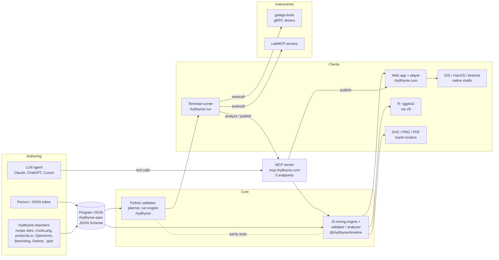

## Architecture decisions

### JSON plus JSON Schema as the language

<dl class="adr" markdown="1">
<dt>Decision</dt>
<dd markdown="1">A program is a JSON document validated against a versioned JSON Schema published as the `rhylthyme-spec` package. The schema's constructs carry workflow and OWL-Time ontology annotations. Older and newer schema versions ship together (0.2.0-alpha and 0.3.0-alpha).</dd>
<dt>Why</dt>
<dd markdown="1">Schema-first means every consumer, whether Python, JavaScript, R, Swift or Kotlin, can check the same file without a custom parser. It also gives LLM agents a precise target that a validator can reject.</dd>
<dt>Trade-off</dt>
<dd markdown="1">Hand-writing it is verbose. In practice people rarely write it directly: assistants and importers produce it, and shorthand like `"5m"` or `"1h30m"` durations reduces the noise.</dd>
</dl>

### One timing engine, embedded everywhere

<dl class="adr" markdown="1">
<dt>Decision</dt>
<dd markdown="1">Step timing (resolving triggers, offsets, buffers and replicates into start and end times) lives in one zero-dependency JavaScript module, `@rhylthyme/timeline`. It ships as UMD, ESM and a `<rhylthyme-timeline>` Web Component. The module was extracted from the web app's `timeline-render.js` "with no code changes relative to the copy shipped there". The MCP server's validator and schedule analyzer were later moved into the same package.</dd>
<dt>Why</dt>
<dd markdown="1">The web player, the MCP server's PNG previews, static Gantt renders, the R package (through V8) and the macOS app's offline player all compute times with the same code, so they agree to the second. Planning against predicted durations doesn't need a second implementation either: it runs the same resolver over a copy of the program that has the predicted durations substituted in.</dd>
<dt>Trade-off</dt>
<dd markdown="1">The Python `rhylthyme-timeline` wrapper needs Node.js on the PATH, and the R package and the server carry vendored copies, which have to be kept in step.</dd>
</dl>

### Two validators held to parity

<dl class="adr" markdown="1">
<dt>Decision</dt>
<dd markdown="1">The offline Python CLI (`rhylthyme validate`) and the JavaScript validator in the engine are independent implementations of the same rules. A CI parity test runs both against every program in `rhylthyme-examples`, every `invalid/<CODE>.json` fixture, and systematic mutations (dropped required keys, wrong types, ambiguous `oneOf`), and fails if any verdict differs. The few deliberate differences are listed by name on both sides.</dd>
<dt>Why</dt>
<dd markdown="1">The CLI has to work with no network and no Node. The hosted server validates in Node, and the program gets checked again when it is published.</dd>
<dt>Trade-off</dt>
<dd markdown="1">Every rule is maintained twice. The parity suite and a shared finding-codes catalogue are what keep that manageable.</dd>
</dl>

### An MCP server as the authoring interface

<dl class="adr" markdown="1">
<dt>Decision</dt>
<dd markdown="1">Agents don't write prose schedules. They make tool calls (`validate_program`, `analyze_schedule`, `visualize_schedule`, `import_from_source`, catalog search, account tools) against a Model Context Protocol server. One implementation serves five endpoints: generic, kitchen, lab, events and gym. Each vertical adds a few one-shot tools of its own. The server also ships the program schema as MCP resources, plus a four-turn `plan_schedule` prompt (read the source back, confirm the model, extract steps with source spans, assign tracks and triggers).</dd>
<dt>Why</dt>
<dd markdown="1">The validator refuses malformed programs before they are published, so the agent gets corrected rather than the person. In the preprint's evaluation on 24 expert-authored programs, the four-turn prompt improved step and dependency extraction on all seven models tested. On the four models that ran the full set, the number of programs that both validated and matched the expert's makespan and critical chain went from at most 4 to between 9 and 16. In short, the prompt mattered more than the model.</dd>
<dt>Trade-off</dt>
<dd markdown="1">The server is stateless Streamable HTTP on Vercel, with OAuth 2.1 for account tools. Long operations such as server-side `import_text`, which makes four or more model calls, are rate-limited per day.</dd>
</dl>

### The human is the executor

<dl class="adr" markdown="1">
<dt>Decision</dt>
<dd markdown="1">Variable and indefinite durations are durations the *person* controls. Manual triggers are gates the person fires. At run time the engine propagates delays along dependency chains, and it does not re-optimize the schedule.</dd>
<dt>Why</dt>
<dd markdown="1">The aim is a timeline someone can follow at the stove or the bench, not an optimal plan they can't keep up with. The auto-planner (finish together, minimize length, consistent coverage, fit to a target time) runs before execution, not during it.</dd>
<dt>Trade-off</dt>
<dd markdown="1">Rhylthyme has no reactive rescheduling and no optimization layer comparable to RCPSP solvers. It checks feasibility and surfaces conflicts, and leaves the final timing to the person.</dd>
</dl>

### Native apps as shells around the web player

<dl class="adr" markdown="1">
<dt>Decision</dt>
<dd markdown="1">The iOS app (SwiftUI), the macOS app (SwiftUI, built with Swift Package Manager and no Xcode project) and the Android app (Kotlin, Jetpack Compose, Material 3) all host the web timeline in a WebView and talk to it over a JavaScript bridge. Native code handles what the OS does better: Live Activities and AlarmKit alarms on iOS, a foreground service, Quick Settings tiles and full-screen alarms on Android, and a menu-bar timer and Dock controls on the Mac.</dd>
<dt>Why</dt>
<dd markdown="1">There is one player implementation, and the native layer adds only background timing and system integration. The Android port treats iOS as the behavioural source of truth but keeps program JSON lossless, so unknown keys such as `replicates` survive a round trip.</dd>
<dt>Trade-off</dt>
<dd markdown="1">The bridge is a real protocol, with message handlers, replay of manual actions after a reload, and speed and clock reconciliation. Offline use requires bundling the player: the Mac app ships a copy pinned to a known revision and checked against fixtures.</dd>
</dl>

### Importers as a separate, offline package

<dl class="adr" markdown="1">
<dt>Decision</dt>
<dd markdown="1">`rhylthyme-importers` uses a `BaseImporter` with an `ImporterRegistry` that picks the importer from the URL. It covers TheMealDB, Spoonacular, recipe-scrapers sites, CookLang, protocols.io, Opentrons Protocol API scripts, Benchling, Ontime and PowerPoint decks. Importers that use an LLM (a universal-recipe fallback and free-text import) stay server-side.</dd>
<dt>Why</dt>
<dd markdown="1">An importer reads structure, not meaning, so it can run offline with no API key. Anything that needs a model client, a key and a rate limiter stays out of the base class. An optional `--review` pass has a model compare the import against the source and report defaulted durations and dropped steps. It doesn't change anything.</dd>
<dt>Trade-off</dt>
<dd markdown="1">Structural imports come out mostly sequential. Parallel tracks and cross-track triggers have to be added by a later enrichment step.</dd>
</dl>

### Instrument bridges outside the core

<dl class="adr" markdown="1">
<dt>Decision</dt>
<dd markdown="1">`rhylthyme-galago` (Science Corp's galago-tools gRPC drivers) and `rhylthyme-labmcp` (K-Dense's LabMCP servers) are optional extras (`rhylthyme[galago]`, `rhylthyme[labmcp]`). A step can name an instrument command. The runner sends it when the step starts, and the step ends when the instrument replies. A local **workcell** file maps tool roles to addresses and safety limits, and it never leaves the lab machine.</dd>
<dt>Why</dt>
<dd markdown="1">Programs stay portable across labs. galago-tools needs Python 3.9 while Rhylthyme needs 3.12+, so the two talk over gRPC from separate environments. Everything runs simulated unless `--live` is passed.</dd>
<dt>Trade-off</dt>
<dd markdown="1">It's still alpha, and live runs depend on a pre-flight check of every instrument's identity, mode and limits.</dd>
</dl>

### An R binding that reuses the engine

<dl class="adr" markdown="1">
<dt>Decision</dt>
<dd markdown="1">The R package's `read_rhylthyme()` times programs with the JavaScript engine embedded through V8, and `geom_rhylthyme()` / `autoplot()` draw them with ggplot2. Lanes can be tracks, steps or resources, and run records (what actually happened) plot on the clock time they ran.</dd>
<dt>Why</dt>
<dd markdown="1">This way a plot in a paper or notebook agrees with the website, and there's no Node dependency.</dd>
<dt>Trade-off</dt>
<dd markdown="1">It's one more vendored engine copy to keep current.</dd>
</dl>

## Tool stack

| Layer | Technology | Repo |
|---|---|---|
| Program language | JSON Schema (0.2.0 / 0.3.0-alpha), Python `jsonschema` | [rhylthyme-spec](https://github.com/rhylthyme/rhylthyme-spec) |
| Core library and CLI | Python 3.12+, Click, PyYAML; curses runner; pytest, black, isort, flake8, mypy | [rhylthyme](https://github.com/rhylthyme/rhylthyme) |
| Timing engine, renderer, player | Zero-dependency JavaScript (UMD + ESM), Web Component, hand-written TypeScript types; SVG/PNG/PDF output | [rhylthyme-timeline](https://github.com/rhylthyme/rhylthyme-timeline) |
| MCP server | Node 20+, `@modelcontextprotocol/server`, `mcp-handler`, zod, optional `@resvg/resvg-js`; Vercel, Dockerfile for self-hosting | [rhylthyme-mcp](https://github.com/rhylthyme/rhylthyme-mcp) |
| Web app | Flask (Vercel Python runtime), D3.js, Tailwind, Claude via the Anthropic API for chat; Supabase Postgres with pgvector and pg_trgm for catalog search | rhylthyme-server (private) |
| Importers | Python, requests, recipe-scrapers, cooklang-py, python-pptx | [rhylthyme-importers](https://github.com/rhylthyme/rhylthyme-importers) |
| R binding | ggplot2, V8, jsonvalidate; R-CMD-check in CI; r-universe | [rhylthyme-r](https://github.com/rhylthyme/rhylthyme-r) |
| Lab instruments | galago-tools over gRPC; LabMCP over MCP | [rhylthyme-galago](https://github.com/rhylthyme/rhylthyme-galago), [rhylthyme-labmcp](https://github.com/rhylthyme/rhylthyme-labmcp) |
| iOS | SwiftUI, WKWebView bridge, ActivityKit Live Activities, AlarmKit, widgets; fastlane | rhylthyme-ios (private) |
| macOS | SwiftUI, Swift 6, Swift Package Manager, sandboxed WKWebView, bundled offline player | rhylthyme-macos (private) |
| Android | Kotlin, Jetpack Compose, Material 3, supabase-kt, OkHttp, foreground service + Quick Settings tiles | rhylthyme-android (private) |
| Examples and gold set | Example programs and environments, invalid fixtures | [rhylthyme-examples](https://github.com/rhylthyme/rhylthyme-examples) |
| Docs | MkDocs Material, GitHub Actions | [rhylthyme-docs](https://github.com/rhylthyme/rhylthyme-docs) |
| CI | GitHub Actions: pytest on 3.12/3.13, `node --test` matrix, JS↔Python parity, schema-bundle and finding-code checks | per repo |

## Screenshots

<div class="shot-grid" markdown>
<figure markdown>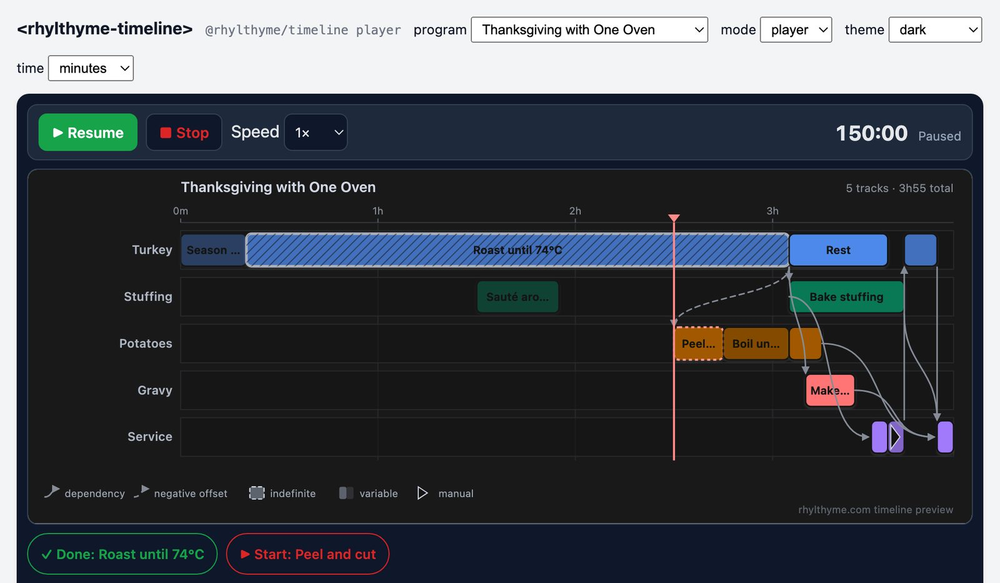<figcaption>The <code>&lt;rhylthyme-timeline&gt;</code> element in its dark theme. Hatched bars are indefinite steps and red-dashed bars wait for a manual start.</figcaption></figure>
<figure markdown>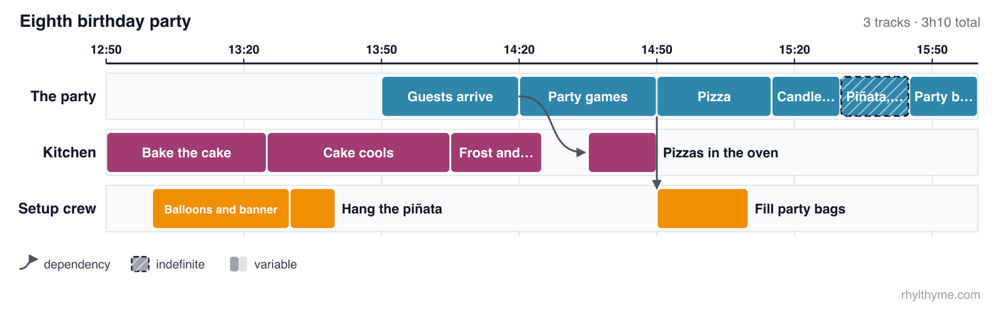<figcaption>A static render from <code>rhylthyme render</code>, working back from a 4:00 pickup, with cross-track dependency arrows.</figcaption></figure>
<figure markdown>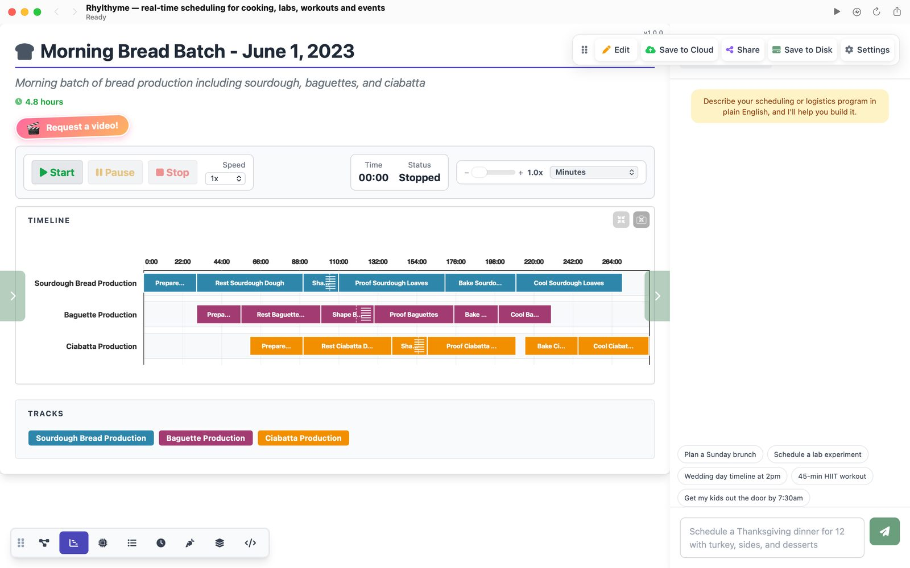<figcaption>The macOS app: three bread lines on a 4.8-hour timeline, with the chat panel on the right.</figcaption></figure>
<figure markdown>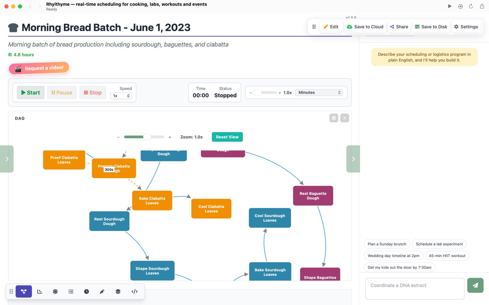<figcaption>The same program as a dependency graph. Dashed edges carry offsets.</figcaption></figure>
<figure markdown>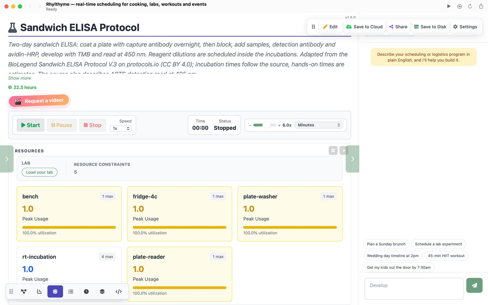<figcaption>The resources view for a two-day sandwich ELISA adapted from protocols.io, showing peak use against each <code>maxConcurrent</code>.</figcaption></figure>
<figure markdown>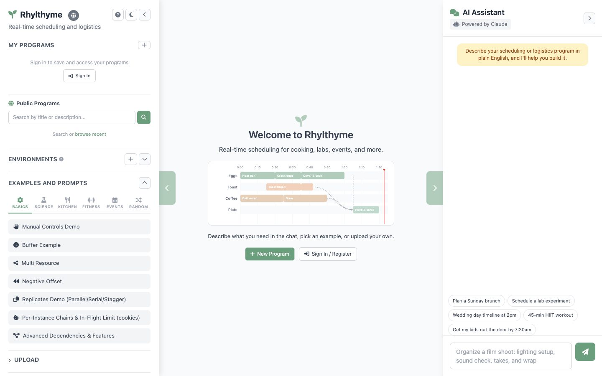<figcaption>rhylthyme.com: examples by vertical, the public program catalog, and a Claude-powered assistant that builds programs from plain English.</figcaption></figure>
<figure markdown>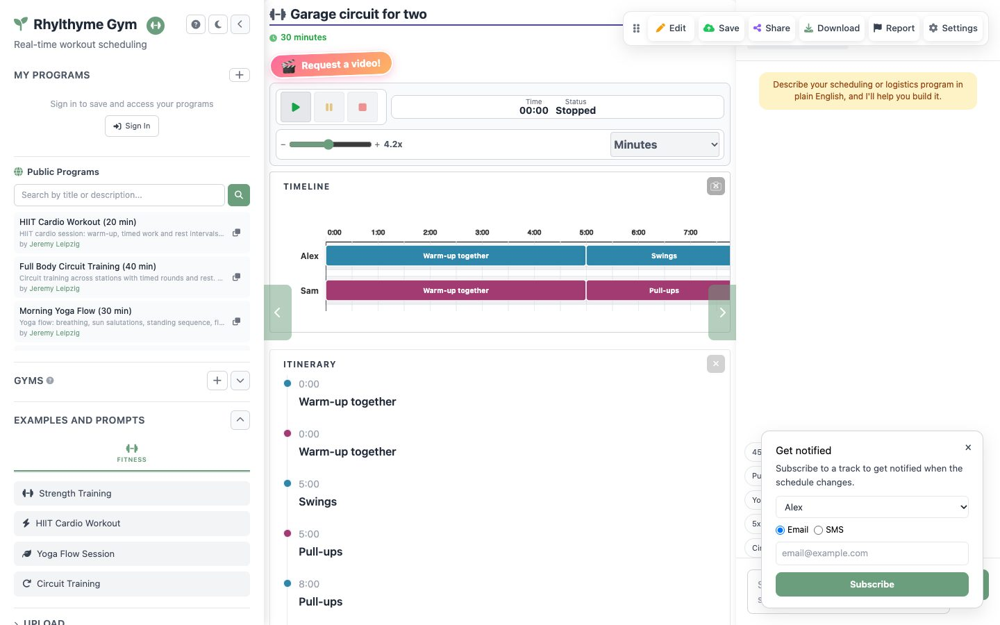<figcaption>A share link produced by the MCP server's <code>visualize_schedule</code>: a two-person garage circuit with no equipment double-booked.</figcaption></figure>
<figure markdown>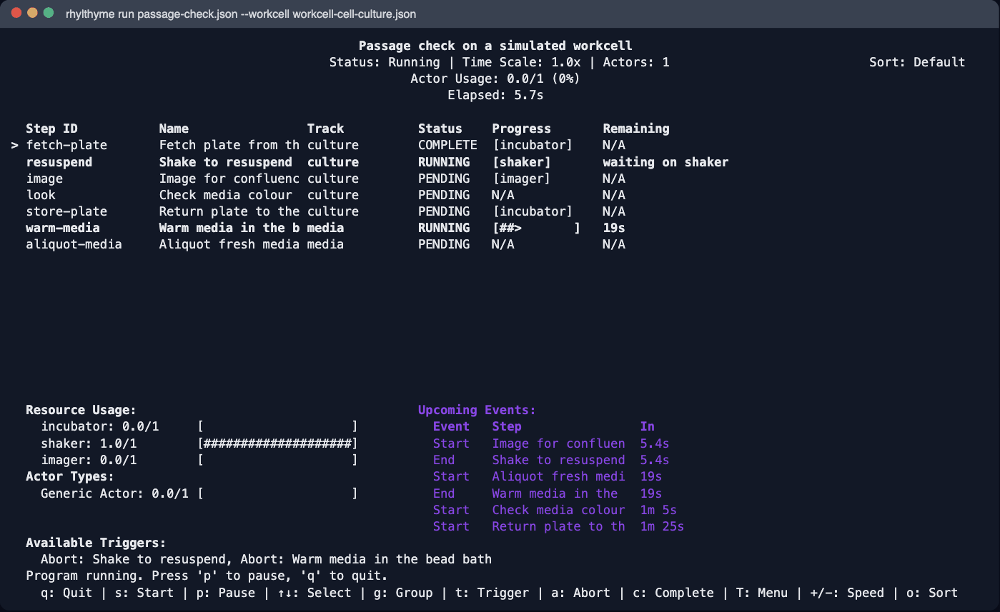<figcaption><code>rhylthyme run</code> with a galago workcell. The shake step stays open until the shaker replies.</figcaption></figure>
<figure markdown>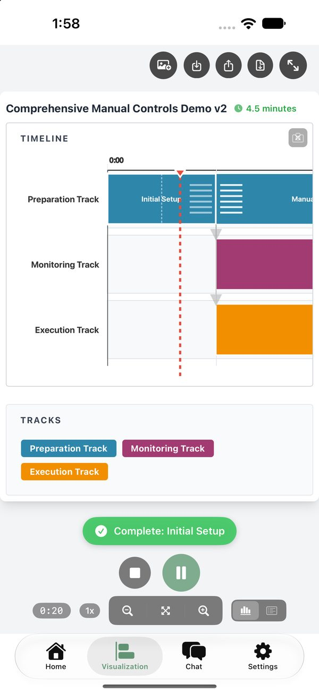<figcaption>iOS, running: the cursor, a manual "Complete" action, and playback controls.</figcaption></figure>
<figure markdown>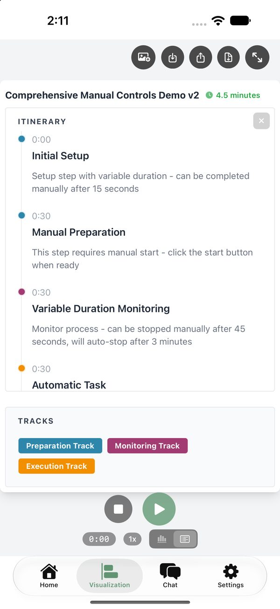<figcaption>iOS itinerary view: the same timings as a list.</figcaption></figure>
<figure markdown><figcaption>A Live Activity on the lock screen, with the manual step completable without unlocking.</figcaption></figure>
<figure markdown>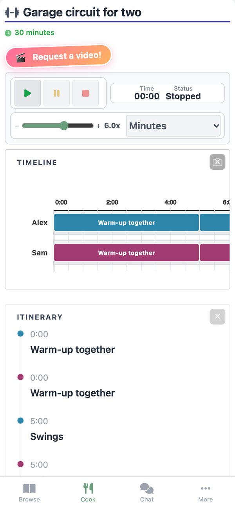<figcaption>The mobile web layout (390 px): timeline, itinerary and bottom navigation.</figcaption></figure>
<figure markdown>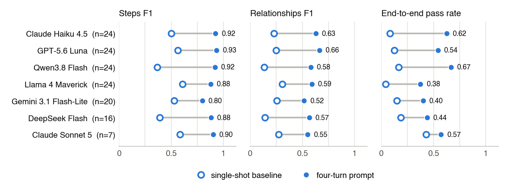<figcaption>From the preprint: single-shot vs. four-turn authoring prompt across seven models.</figcaption></figure>
<figure markdown>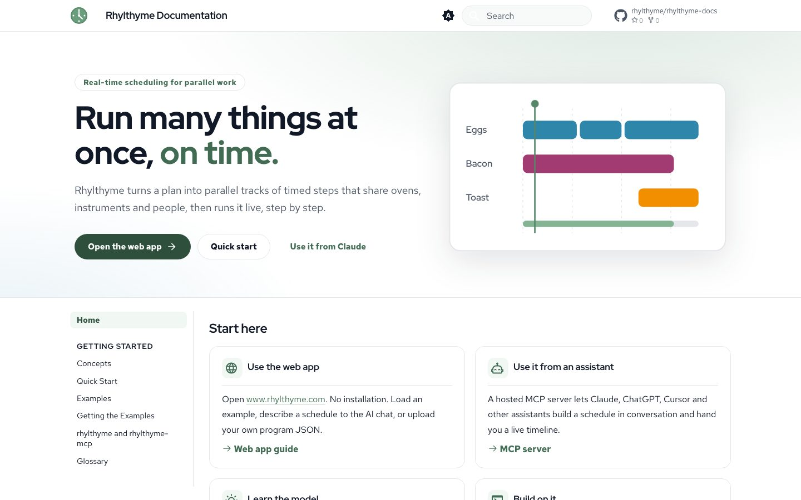<figcaption>The documentation site (MkDocs Material).</figcaption></figure>
</div>

## Links

- **Live app:** [rhylthyme.com](https://www.rhylthyme.com), with vertical sites at [kitchen](https://kitchen.rhylthyme.com), [lab](https://lab.rhylthyme.com), [events](https://events.rhylthyme.com) and [gym](https://gym.rhylthyme.com)
- **MCP server:** `https://mcp.rhylthyme.com/mcp` (also `/kitchen/mcp`, `/lab/mcp`, `/events/mcp`, `/gym/mcp`); listed in the [Claude Connectors Directory](https://claude.ai/directory/rhylthyme)
- **Docs:** [docs.rhylthyme.com](https://docs.rhylthyme.com)
- **Source:** [github.com/rhylthyme](https://github.com/rhylthyme): [rhylthyme](https://github.com/rhylthyme/rhylthyme), [rhylthyme-spec](https://github.com/rhylthyme/rhylthyme-spec), [rhylthyme-timeline](https://github.com/rhylthyme/rhylthyme-timeline), [rhylthyme-mcp](https://github.com/rhylthyme/rhylthyme-mcp), [rhylthyme-importers](https://github.com/rhylthyme/rhylthyme-importers), [rhylthyme-r](https://github.com/rhylthyme/rhylthyme-r), [rhylthyme-galago](https://github.com/rhylthyme/rhylthyme-galago), [rhylthyme-labmcp](https://github.com/rhylthyme/rhylthyme-labmcp), [rhylthyme-examples](https://github.com/rhylthyme/rhylthyme-examples), [rhylthyme-docs](https://github.com/rhylthyme/rhylthyme-docs)
- **Packages:** `pip install rhylthyme` · `npm i @rhylthyme/timeline` · `remotes::install_github("rhylthyme/rhylthyme-r")`
- **Preprint:** *Rhylthyme: A Declarative Language and Agent-Native Runtime for Human-Executed, Resource-Constrained Schedules* (J. Leipzig, 2026). The LaTeX source and figures are at [github.com/rhylthyme/paper](https://github.com/rhylthyme/paper), and the prompt-evaluation harness and its results are in [rhylthyme](https://github.com/rhylthyme/rhylthyme)
